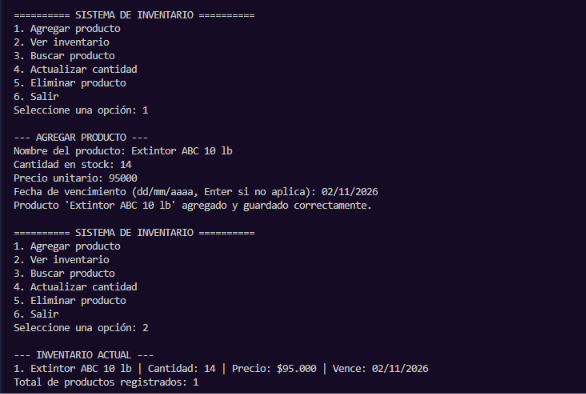

# Caso de Prueba CP-01

- **Responsable:** Yeferson Calderón Camacho
- **Módulo:** Registro de datos
- **Qué se escribió:** Opción 1 (Agregar producto). Nombre: `Extintor ABC 10 lb`. Cantidad: 14. Precio: 95000. Fecha de vencimiento: 02/11/2026. Luego opción 2 (Ver inventario).
- **Qué pasó:** El programa aceptó todos los datos sin errores y mostró "Producto 'Extintor ABC 10 lb' agregado y guardado correctamente." Al elegir la opción 2 listó el producto: `1. Extintor ABC 10 lb | Cantidad: 14 | Precio: $95.000 | Vence: 02/11/2026`.
- **Resultado:** Aprobado

