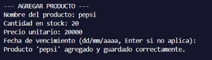

# Caso de Prueba CP-05

- **Responsable:** Yeferson Calderón Camacho
- **Módulo:** Registro de datos
- **Qué se escribió:** Opción 1 (Agregar producto). En el nombre se presionó Enter sin escribir nada, luego se escribieron solo espacios, y por último `Tapabocas N95`. Cantidad: 60. Precio: 65000. Fecha: vacía.
- **Qué pasó:** Las dos veces con el nombre vacío el programa mostró "Error: este campo no puede estar vacío." y volvió a pedir el nombre. Con `Tapabocas N95` aceptó el dato, pidió cantidad, precio y fecha, y mostró "Producto 'Tapabocas N95' agregado y guardado correctamente."
- **Resultado:** Aprobado

