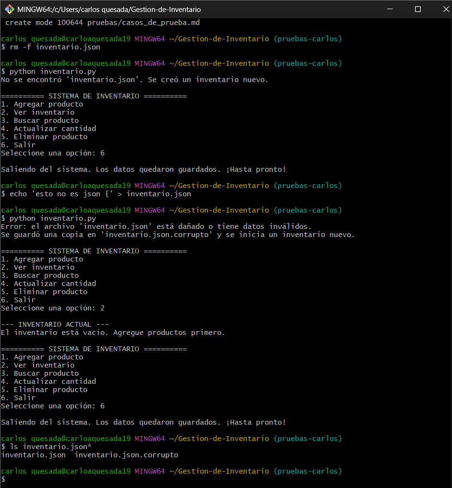

# CP-09 Archivo inexistente

- **Responsable:** Carlos Andrés Portela Quesada (QA)
- **Fecha:** 25/10/2026
- **Módulo:** Persistencia

## Qué escribí
1. Con el programa cerrado, borré el archivo de datos: `rm -f inventario.json` (equivalente en Git Bash de `Remove-Item inventario.json`).
2. Ejecuté `python inventario.py`.
3. Salí con la opción `6`.

## Resultado esperado
El programa dice "No se encontró 'inventario.json'. Se creó un inventario nuevo." y abre el menú sin error.

## Qué pasó
El programa mostró "No se encontró 'inventario.json'. Se creó un inventario nuevo.", creó el archivo y abrió el menú principal normalmente, sin errores ni cierre inesperado.

## Resultado: APROBADO

