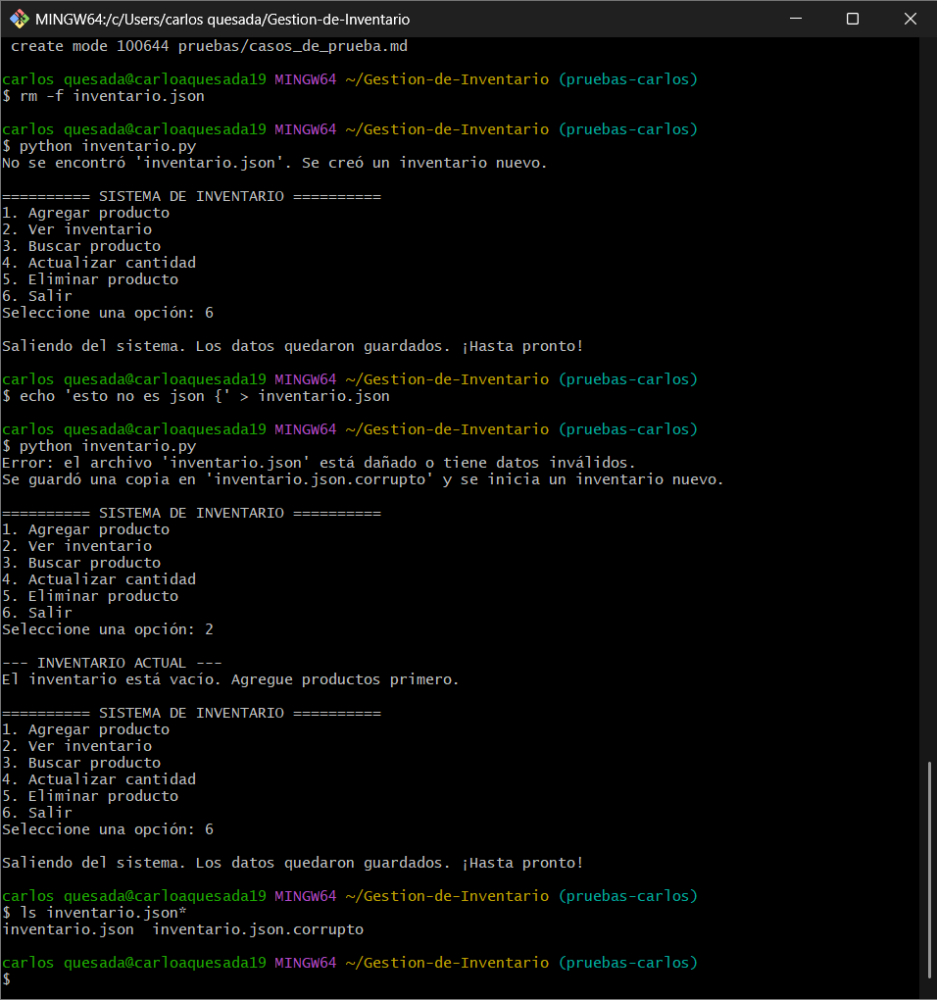

# CP-10 Archivo dañado

- **Responsable:** Carlos Andrés Portela Quesada (QA)
- **Fecha:** 25/10/2026
- **Módulo:** Persistencia

## Qué escribí
1. Con el programa cerrado, dañé el archivo de datos: `echo 'esto no es json {' > inventario.json` (equivalente en Git Bash de `Set-Content inventario.json "esto no es json {"`).
2. Ejecuté `python inventario.py`.
3. Elegí la opción `2` para ver el inventario.
4. Salí con la opción `6`.

## Resultado esperado
El programa avisa que el archivo está dañado, crea `inventario.json.corrupto` y abre con el inventario vacío, sin cerrarse.

## Qué pasó
El programa mostró "Error: el archivo 'inventario.json' está dañado o tiene datos inválidos." y "Se guardó una copia en 'inventario.json.corrupto' y se inicia un inventario nuevo.". Abrió el menú normalmente y la opción 2 mostró "El inventario está vacío. Agregue productos primero.". No se cerró en ningún momento. Se comprobó con `ls inventario.json*` que existe el archivo `inventario.json.corrupto`.

## Resultado: APROBADO

