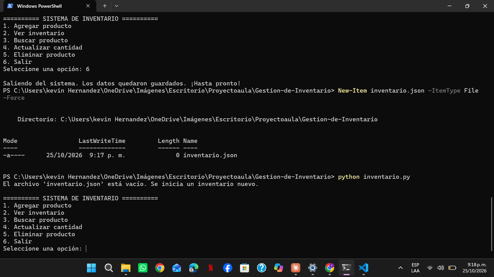

# CP-11 – Archivo vacío

**Responsable:** Kevin Mauricio Hernández Valenzuela

**Qué hice:** Con el programa cerrado ejecuté `New-Item inventario.json -ItemType File -Force`, que dejó el archivo `inventario.json` con 0 bytes. Luego ejecuté `python inventario.py`.

**Qué pasó:** El programa mostró "El archivo 'inventario.json' está vacío. Se inicia un inventario nuevo." y abrió el menú principal normalmente, sin errores.

**Resultado:** Aprobado

