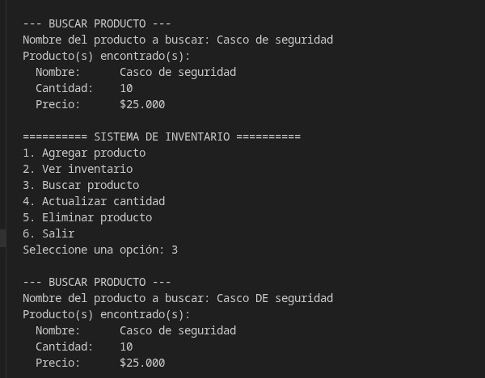
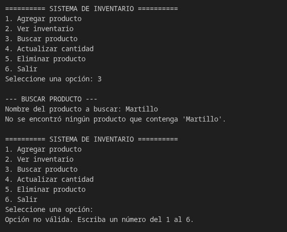

# CP-17 Buscar producto

- **Responsable:** Juan Sebastian Pérez Poveda
- **Qué se escribió:** Se seleccionó la opción 3 para buscar producto. Se ingresó primero `casco DE seguridad`, luego el producto inexistente `Martillo`, y finalmente se presionó `Enter` sin escribir texto.
- **Qué pasó:** El sistema buscó sin distinguir mayúsculas ni minúsculas y encontró el "Casco de seguridad". Con `Martillo` avisó que no lo encontró. Al enviar el campo vacío, mostró el error de campo requerido.
- **Resultado:** Aprobado

