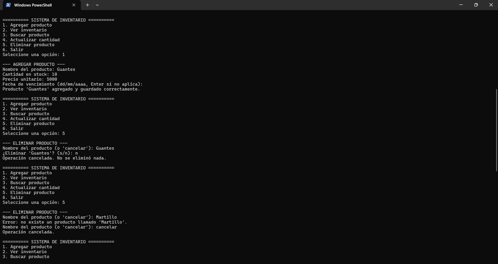
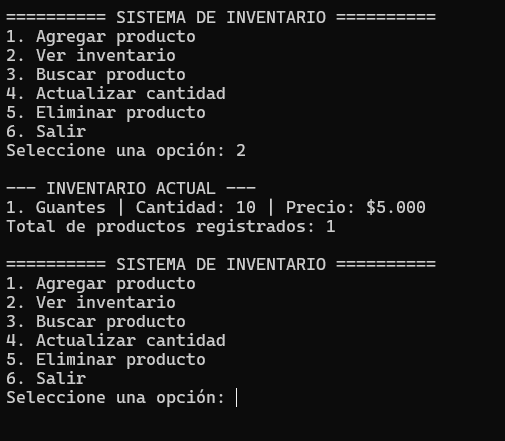

# CP-20 Eliminar producto inexistente y cancelar

- **Responsable:** Juan José Roso Casanova
- **Fecha:** 5 de noviembre de 2026
- **Resultado esperado:** con `Martillo` dice que no existe un producto llamado "Martillo" y vuelve a pedir el nombre; con `cancelar` dice "Operación cancelada"; `Guantes` sigue en el inventario.
- **Resultado obtenido:** con `Martillo` salió "Error: no existe un producto llamado 'Martillo'" y volvió a pedir el nombre; con `cancelar` salió "Operación cancelada."; el inventario sigue mostrando Guantes (cantidad 10, precio $5.000). Antes de la prueba también intenté eliminar Guantes y responder `n`, y salió "Operación cancelada. No se eliminó nada."
- **Estado:** Aprobado

